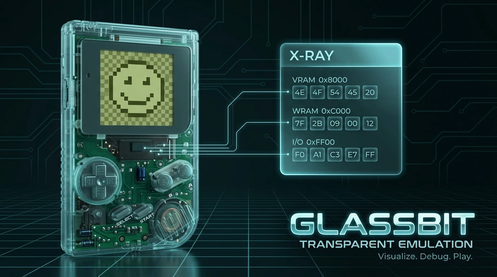
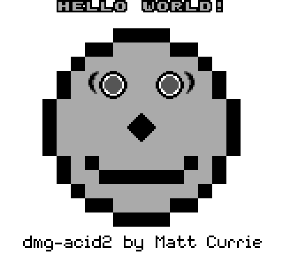
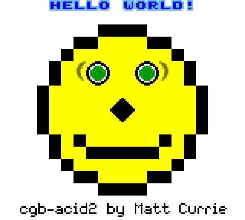
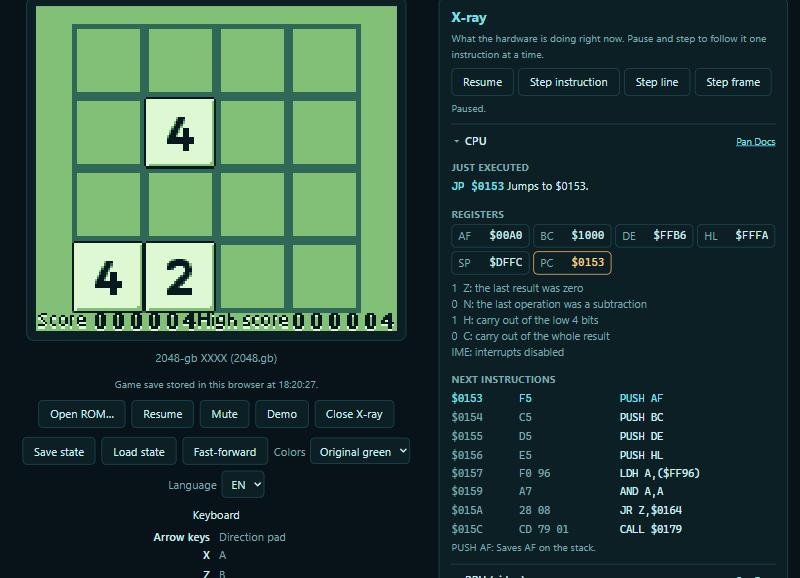

<p align="center"></p>

# Glassbit

[](https://github.com/MatheusSenra/glassbit/actions/workflows/ci.yml)
[](https://matheussenra.github.io/glassbit/)

A Game Boy and Game Boy Color emulator written in Rust that runs in the
browser through WebAssembly, built to **show how the hardware works while the game runs**.

**[Try it in your browser](https://matheussenra.github.io/glassbit/)**: it
starts with a built-in demo, and you can load your own ROM.

<p align="center">
  <br>
  <em>The homebrew <a href="https://github.com/Sanqui/2048-gb">2048-gb</a> by Sanqui, recorded by Glassbit's own runner.</em>
</p>

<p align="center">
  
  <br>
  <em>The dmg-acid2 and cgb-acid2 video tests, both pixel-exact.</em>
</p>

<p align="center">
  <br>
  <em>The X-ray panel: paused between two instructions, with the changed register highlighted.</em>
</p>

## What it does

- Runs Game Boy and Game Boy Color games on ROM-only, MBC1, MBC3 and MBC5
  cartridges, with video, sound and input. Color games get the Color's
  palettes, banked memory, VRAM DMA and double speed.
- Keeps battery saves in the browser, one per cartridge, and exports or
  imports them as `.sav` files compatible with other emulators.
- Save states: freeze the whole machine and come back to that moment later.
- Fast-forward at four times the speed, and four color palettes.
- **Link cable over the internet**: two players connect their browsers
  directly with WebRTC, by exchanging an invite and an answer code.
- **X-ray panel**, in English or Portuguese, with links to the matching
  [Pan Docs](https://gbdev.io/pandocs/) pages:
  - **CPU**: registers and flags, the next instructions disassembled, and a
    sentence saying what the instruction you just stepped did.
  - **PPU**: mode and line, the background map with the visible area
    outlined, the tiles in video memory and the sprites on the current line.
  - **Memory**: the memory map with where each register pair points, and the
    hardware registers by name with their latest writes.
  - **Interrupts and timer**: what is enabled and requested, and the latest
    interrupts served.
  - **Breakpoints**: stop before an instruction runs or right after the CPU
    writes to an address.
  - **Memory viewer**: any 256 bytes in hexadecimal, optionally following PC,
    SP or HL, with the bytes a step changed highlighted.

Not there yet: the MBC3 real-time clock does not tick, MBC2 cartridges are
not supported, games made only for the original Game Boy always run on a DMG
(the Color's compatibility mode, which colorizes them, is not emulated), and
effects that change video registers in the middle of a scanline may look
different from real hardware.

## Using it

| Key | Button |
| --- | --- |
| Arrow keys | Direction pad |
| X | A |
| Z | B |
| Enter | Start |
| Shift | Select |
| Space (hold) | Fast-forward |

Load a ROM with **Open ROM** or by dropping the file on the page. ROMs stay
in your browser and are never uploaded. Sound starts after your first click
or key press, as browsers require.

**Save state** and **Load state** keep one snapshot per game in the browser.
They are separate from the game's own battery save, which is stored
automatically whenever the game writes it. **Export .sav** and **Import
.sav** move that battery save in and out of the browser; importing restarts
the game with it.

**Link cable** connects two browsers. One player clicks **Host a game** and
sends the invite code to the other (by chat, for example); the other pastes
it under **Join a game** and sends back the answer code; the host pastes it
and clicks **Connect**. Both need the same game loaded. The game data goes
directly between the browsers; a public STUN server is only asked for each
browser's internet address. Some strict networks block direct connections.

Open **X-ray**, pause, and use the step buttons to advance one instruction,
one scanline or one frame. Click an instruction in the CPU section to put a
breakpoint on it. Breakpoints only act while the panel is open; with it
closed nothing is recorded and the game runs at full speed.

## How it is built

- Reasonable timing accuracy from the start: hardware advances in lockstep, one M-cycle at a time.
- A platform-independent core that can be driven by a browser, a test runner or anything else.
- Written from documentation ([Pan Docs](https://gbdev.io/pandocs/)), not from other emulators' code.

| Crate | What it is |
| --- | --- |
| `crates/core` (`glassbit-core`) | The emulator. No browser, window or audio dependencies. |
| `crates/web` (`glassbit-web`) | WebAssembly bindings (`wasm-bindgen`) and the page in `www/`. |
| `crates/runner` (`glassbit-runner`) | Headless native runner: runs test ROMs and reports whether they passed, saves screenshots and records GIFs. |

## Building

You need [Rust](https://rustup.rs); the pinned toolchain in `rust-toolchain.toml`
installs itself, including the wasm target.

```bash
cargo test --workspace
```

Tests that need the downloaded test ROMs (see below) skip themselves when the
ROMs are missing.

### The web page

Install [wasm-pack](https://rustwasm.github.io/wasm-pack/), build the wasm
package into the page's folder and serve that folder with any static server:

```bash
wasm-pack build crates/web --target web --out-dir www/pkg
```

```bash
python -m http.server 8765 --directory crates/web/www
```

Then open <http://localhost:8765>. Pushing to `main` publishes the same folder
to GitHub Pages.

### The runner

```bash
cargo run --release -p glassbit-runner -- "test-roms/game-boy-test-roms/blargg/cpu_instrs/cpu_instrs.gb"
```

This prints the cartridge header and the test's verdict. Options:

| Option | Effect |
| --- | --- |
| `--frames N` | Give up (or stop recording) after N frames. |
| `--screenshot out.png` | Save the final screen. |
| `--reference ref.png` | Pass or fail by comparing the screen with an image. |
| `--gif out.gif` | Record the run as an animation instead of looking for a verdict. |
| `--press "start@80-86,left@150-156"` | While recording, hold buttons during the given frames. |

## Test ROMs

Test ROMs are not part of this repository. Download them into `test-roms/` (git-ignored) with:

```bash
bash scripts/fetch-test-roms.sh
```

This fetches a pinned release of
[c-sp/game-boy-test-roms](https://github.com/c-sp/game-boy-test-roms) (Blargg,
Mooneye, dmg-acid2) and the
[SingleStepTests/sm83](https://github.com/SingleStepTests/sm83) CPU test
vectors. Pass `--no-sm83` to skip the latter, which is large.

## Accuracy

What passes today, all of it checked by `cargo test` in CI:

| Suite | Result |
| --- | --- |
| SingleStepTests/sm83 | all 500 opcodes, 1000 cases each, including per-cycle bus activity |
| Blargg `cpu_instrs` | all 11 |
| Blargg `instr_timing` | pass |
| Blargg `mem_timing` | all 3 |
| Blargg `dmg_sound` | 9 of 12 (not the three about wave RAM access while playing) |
| dmg-acid2 | pixel-exact match with the reference image |
| cgb-acid2 | pixel-exact match with the reference image |
| Mooneye `acceptance/timer` | all 13 |
| Mooneye `emulator-only/mbc1` | 12 of 13 (all but the multicart one) |
| Mooneye `emulator-only/mbc5` | all 8 |
| MBC3 bank tester | pixel-exact match with the reference image |
| Save states | a restored console stays identical to the original, frame by frame, on seven test ROMs |
| Mooneye `acceptance`, other | 44, covering instruction, interrupt, HALT, OAM DMA and PPU mode timing and the post-boot state |

Of the Mooneye acceptance tests that do not pass, most target console models
other than the DMG. The rest are five PPU tests that need pixel-level timing
(the PPU draws a whole line at once), two `-GS` timing tests, and one that
depends on I/O registers not implemented yet.

## Roadmap

- [x] **Phase 0: Foundation.** Workspace, CI, licenses, test ROM script.
- [x] **Phase 1: Cartridge and bus.** Header parsing, ROM-only cartridge, full memory map.
- [x] **Phase 2: CPU.** All opcodes, validated against SingleStepTests and the individual Blargg `cpu_instrs` ROMs; serial port.
- [x] **Phase 3: Interrupts and timer.** IME, HALT (and its bug), EI delay, DIV/TIMA/TMA/TAC. Blargg `instr_timing`, `mem_timing`, all of `cpu_instrs` and Mooneye timer tests.
- [x] **Phase 4: PPU.** Modes, STAT, background, window, sprites, OAM DMA. Pixel-exact `dmg-acid2`.
- [x] **Phase 5: Playable web frontend.** Canvas, frame loop, keyboard, ROM loading, joypad, built-in demo cartridge, MBC1.
- [x] **Phase 6: Mappers and saves.** MBC3 (clock registers present but not ticking), MBC5, battery RAM persisted in the browser.
- [x] **Phase 7: Audio.** All four APU channels through an AudioWorklet.
- [x] **Phase 7.5: X-ray mode.** Live CPU, PPU, memory and interrupt panels, in English and Portuguese.
- [x] **Phase 8: Polish.** GitHub Pages deploy, save states, fast-forward, palettes.
- [x] **Phase 9: Debugging and saves.** `.sav` export and import, breakpoints, memory viewer.
- [x] **Phase 10: Link cable.** Two browsers linked over WebRTC.
- [x] **Phase 11: Game Boy Color.** Color palettes and tile attributes, VRAM and WRAM banks, VRAM DMA, double speed. Pixel-exact `cgb-acid2`.


## Legal

Glassbit contains no Nintendo code. It does not include or need the boot ROM:
the console starts in the documented post-boot state. No commercial ROMs are
distributed with it, and none will be accepted in this repository.

Game Boy is a trademark of Nintendo. This project is not affiliated with or
endorsed by Nintendo.

## License

Licensed under either of

- Apache License, Version 2.0 ([LICENSE-APACHE](LICENSE-APACHE))
- MIT license ([LICENSE-MIT](LICENSE-MIT))

at your option.

Unless you explicitly state otherwise, any contribution intentionally submitted
for inclusion in this work by you, as defined in the Apache-2.0 license, shall
be dual licensed as above, without any additional terms or conditions.
